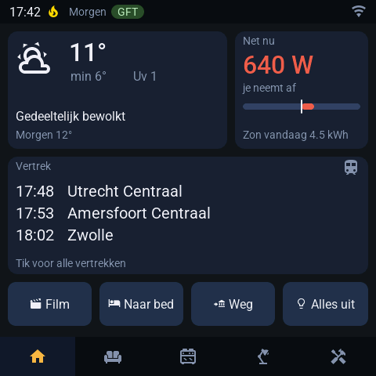
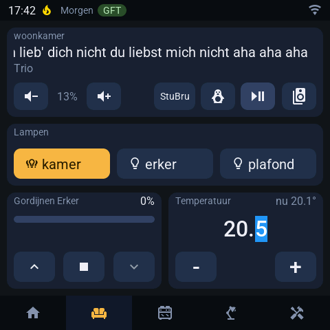
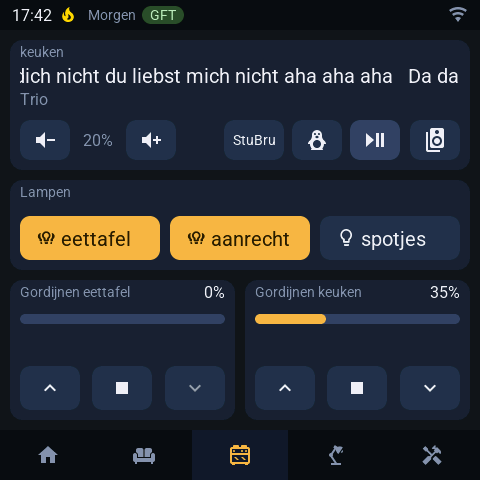
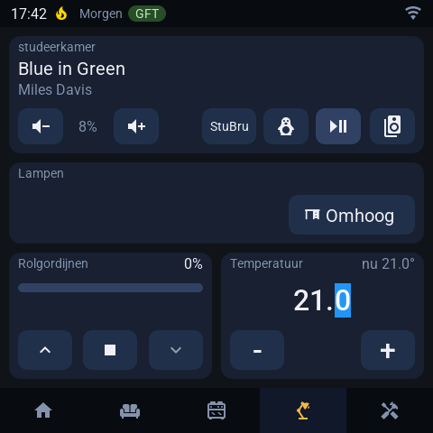
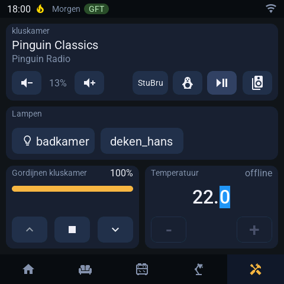
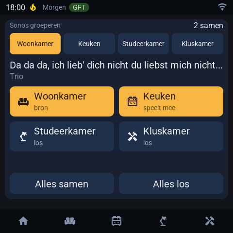
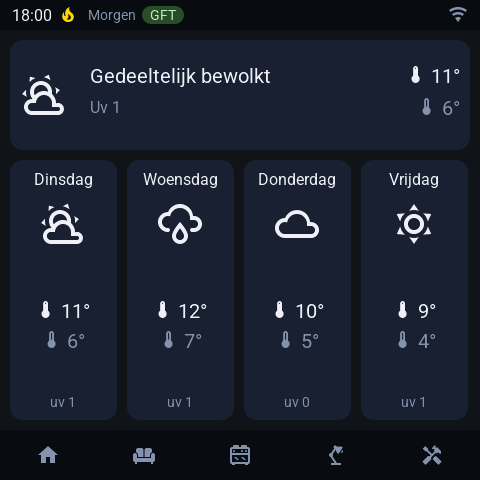
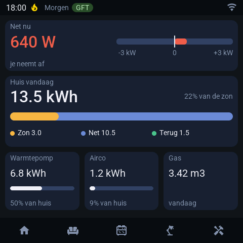
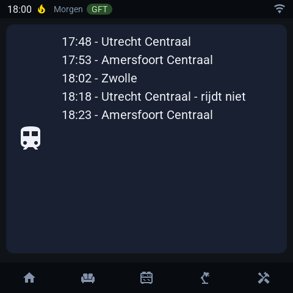

**Project: Touch Display Layouts with ESPhome and Guition 4 480x480 Display**  

This project focuses on designing intuitive layouts for a Guition 4 480x480 ESP32 Smart Display with LVGL support. The display is configured using **ESPhome**, drawing inspiration from resources such as the Home Assistant forum and the ESPhome Cookbook LVGL: Tips and Tricks.  

### Specifications of the Display  
- **Model:** Guition 4 480x480 ESP32-S3 4848S040 Smart Display  
- **Support:** LVGL (Light and Versatile Graphics Library)  
- **Resolution:** 480 x 480 pixels  
- **Interface:** Touchscreen  

### Configuration  
All Home Assistant entities (lights, covers, climate, media players, sensors and scenes) are defined in **`settings.yaml`**. When a device is replaced in Home Assistant, only its entity_id in that file needs to change. Screen brightness, the dim timeout and the thermostat range are set there as well.

#### Home Screen  
- **Status bar:** time, stookwijzer alert, waste collection tomorrow and connection icon  
- **Weather:** icon, temperature and tomorrow's forecast  
- **Energy:** current grid power (red = consuming, green = returning) and today's solar yield  
- **Train departures:** next three trains, tap for all departures  
- **Scenes:** four buttons (Film, Naar bed, Weg, Alles uit), configurable in `settings.yaml`  
- **Navigation bar:** home and the four rooms  

#### Room Template  
Each room page has the same layout:  
- **Media player:** current track, volume, radio presets, play/pause and a button to group Sonos speakers  
- **Lights:** up to three toggle buttons, highlighted when on  
- **Curtains:** position bar with open, stop and close buttons  
- **Temperature:** set point with + and –; changes are sent to the thermostat once you stop tapping  

Devices that are unavailable in Home Assistant are shown greyed out (or as "offline") and cannot be operated.

| Woonkamer | Keuken |
|---|---|
|  |  |
| **Studeerkamer** | **Kluskamer** (thermostat offline) |
|  |  |

#### Sonos Grouping  
Opened from the speaker button in a room's media player. Pick a source, then tap speakers to let them play along or leave the group. "Alles samen" and "Alles los" group or ungroup all speakers at once.

#### Weather Forecast  

#### Energy Overview  

#### Train Departures  

### Display behaviour  
- After a period without touch the screen dims and returns to the home screen.  
- The first touch on a dimmed or switched-off screen only wakes it up, so nothing is switched by accident.  
- Home Assistant can switch the backlight off entirely (e.g. at night).  

### Inspiration and Resources  
- [Home Assistant Forum: Guition 4 480x480 Project](https://community.home-assistant.io/t/guition-4-480x480-esp32-s3-4848s040-smart-display-with-lvgl/729271/1)  
- ESPhome Cookbook LVGL: **Tips and Tricks**  

This project aims to deliver a user-friendly and visually appealing solution for smart room control and streamlined system information.  

If you have any ideas or feedback, feel free to contact me!
